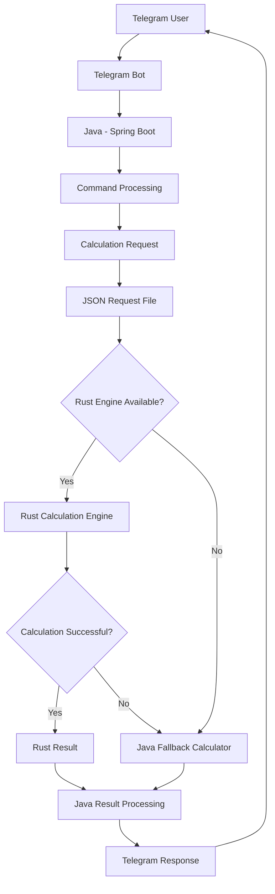

# System Architecture
   The application consists of several components that work together to process user requests and perform scientific calculations.

## System Architecture Diagram

Component Responsibilities
 -  Bot:

Receives messages and commands.
Sends responses to users.
Acts as the communication interface.

-  Application:

Processes incoming commands.
Validates calculation requests.
Prepares JSON requests.
Communicates with the Rust engine.
Handles errors and fallback calculations.
Formats calculation results.

-  Calculation Engine:

Receives JSON calculation requests.
Parses input data.
Executes calculations.
Returns calculation results.

-  Fallback Calculator:

Provides an alternative calculation implementation.
Takes over when Rust is unavailable or fails.
Allows calculations to continue without depending entirely on Rust.

### Calculation Architecture
Calculation Workflow 

The calculation process follows these steps:
1) A user sends a calculation command to Telegram.
2) Java receives and processes the command.
3) Java validates the input.
4) Java prepares a JSON file containing the calculation request.
5) The JSON request is sent to the Rust engine.
6) Rust processes the calculation.
7) Rust returns the calculation result to Java.
8) Java validates and processes the result.
9) Java sends the final response to Telegram.
10) If Rust is unavailable or encounters an error, Java uses its own calculator instead.

# Database Architecture
The application uses PostgreSQL for persistent data storage.

Spring Data JPA provides database interaction, while Liquibase manages database schema migrations.

Responsibilities
-   PostgreSQL

Stores persistent application data.
Maintains structured scientific information.
- Spring Data JPA

Provides object-relational mapping.
Handles database operations.
- Liquibase

Tracks database schema changes.
Applies migrations.
Helps maintain consistent database structure.
